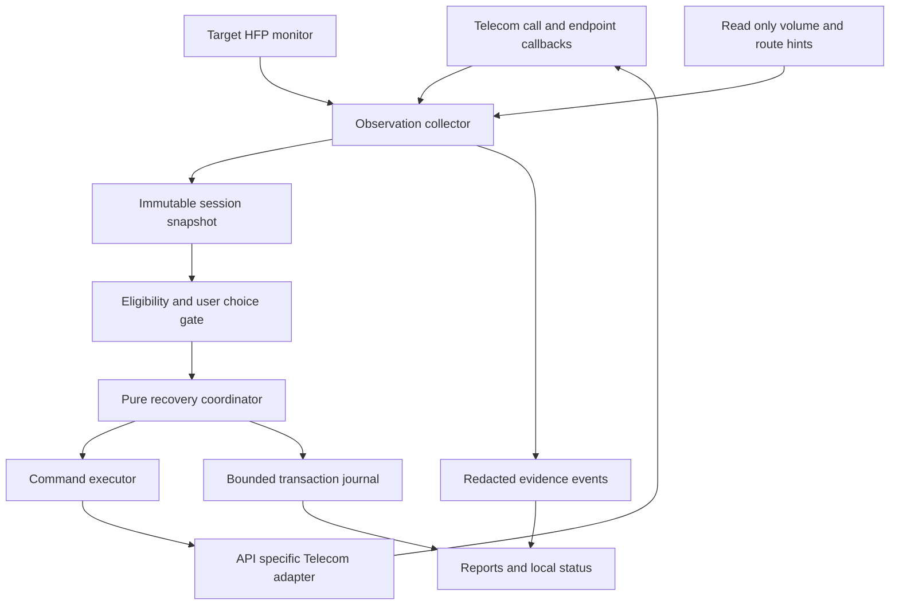

# Automatic Bluetooth call recovery refactoring plan

Plan date: 15 October 2026. Status: proposed implementation and validation roadmap, based on repository `5f3a77d` and the [research and code audit](RESEARCH_2026-10-15.md). This plan does not claim that the proposed behavior has been implemented or verified on a phone.

The [implementation backlog](IMPLEMENTATION_PLAN.md) turns this roadmap into twelve ordered pull requests with class contracts, migrations, test requirements and completion gates.

## Intended outcome and feasibility gate

After initial permissions and call-access setup, an eligible call should recover without the user reopening the app, restarting the phone, toggling Bluetooth, or changing call routes. Keep the existing Telecom-bound lifecycle: the app need not remain visibly open or run a permanent watchdog.

Prove two things before promising that experience: the stock A52s actually gives the app durable routing authority, and the recovery actually restores sound in the affected fault state. If either fails, retain an experimental scope rather than disguising manual instructions as automatic recovery. Firmware/HAL failures beyond available authority remain outside the ordinary-app guarantee.

Initial validation target: SM-A528B on Android 14/One UI 6.1, including the locally reported `A528BXXSBGYI3`, with one affected car and one headset. Other models/builds remain unverified until their own records exist. API compatibility across Android 12–16 is a separate dimension from proven fault recovery.

## Product requirements

| ID | Requirement | Acceptance evidence |
| --- | --- | --- |
| R1 | No corrective user action during supported recovery | Witnessed faulty call recovers automatically; no UI, restart, toggle or re-pair |
| R2 | Operate only on an authorized, exposed call and intended accessory | Selected endpoint and eligible call captured in every transaction |
| R3 | Respect handset, speaker, wired and external streaming choices | Adversarial traces cause immediate yield; no later command restores Bluetooth |
| R4 | Bound disruption | Every request and retry is counted, timed and canceled when ineligible |
| R5 | Describe results honestly | Control-plane status and audible outcome stored independently |
| R6 | Survive lifecycle changes conservatively | Rebind/update/restart tests never repeat an already attempted preventive repair blindly |
| R7 | Protect privacy by construction | Export schema cannot include handles, numbers, names, raw addresses or audio |
| R8 | Keep normal operation local | Recovery works offline; no remote configuration or telemetry dependency |
| R9 | Leave emergency and complex calls alone | Read-only fixture tests for emergency, conference, waiting, held and external calls |
| R10 | Learn from actual device results | Compatibility records link app version, firmware, accessory and test protocol |

Initial consent is unavoidable for permissions and access; the goal concerns recurring corrective work after setup. Package updates may require Android installer confirmation and must not interrupt a call.

## Proposed architecture

Keep `:core` pure Java and `:app` as platform adapters. Avoid new Gradle modules until ownership boundaries require them.

All decisions and command completions run on one serialized dispatcher. Persist only small journal checkpoints off the critical callback path. Every delayed event contains a session generation and transaction ID; late events cannot act on a new call.

### Domain model

Extend `CallAudioSnapshot` with an immutable context rather than multiplying ambiguous booleans:

- `SessionKey`, local `CallKey`, generation and monotonic observation time; wall time only for display.
- Call eligibility: active/dialing/held, emergency status including unknown, conference/child/external flags, count of relevant calls, managed versus unsupported call type.
- Target: locally stored accessory key, ephemeral Telecom endpoint identity, transport type, available/current endpoint, and mapping confidence.
- `Evidence<T>`: value, `KNOWN/UNKNOWN/UNAVAILABLE/STALE`, source and timestamp. A permission failure must not become “disconnected.”
- Transport status scoped to the target. BLE, hearing aids and Classic HFP require distinct evidence rules; lack of Classic SCO cannot diagnose a BLE failure.
- Call-route observations and audio-attribute route predictions as different fields.
- Relevant volume readback, policy support, last user-approved level and whether it changed externally.

Introduce `RecoveryCapabilities` for observable and executable operations, `RecoveryPolicy` for validated device/accessory behavior, and `CommandResult` for accepted/rejected/error/timeout/stale outcomes. Current setup availability, last successful binding and validated recovery profile belong in separate status fields.

### Android routing adapters

Use an interface such as `TelecomAudioController` with `currentEndpoint()`, `availableEndpoints()`, `requestEndpoint(target, transactionId)`, and callback registration. It returns typed events instead of pretending a void route call succeeded.

On API 34+, consume Telecom-provided endpoints and their callbacks; retain the platform endpoint object for requests. Do not fabricate endpoints or persist their IDs as permanent accessory identifiers. On API 31–33, use legacy audio state with a specific Bluetooth device request where available; verify the observed active device. These are implementation choices following the platform contracts cited in the research.

For API 37 experimentation, integrate `onCallEndpointRequested()` behind an API guard as an extra user-choice signal. Do not base Android 14 correctness on it. Keep legacy fallback explicit and tested; an endpoint error must not silently cascade through multiple uncontrolled API paths.

Multiple accessories require special care: map a chosen physical accessory to an endpoint only when there is enough evidence. Duplicate display names are not identities. If the public endpoint data cannot be mapped confidently, permit observation and require the already selected Bluetooth endpoint for a preventive action; do not guess which car/headset to seize.

## Recovery policy and transaction protocol

### Eligibility before every command

Re-evaluate immediately before execution, not just when an operation starts. Require protection enabled, call access present, the same live eligible call, target available, no user override, and remaining budget. Suppress disruptive recovery for emergency/unknown-emergency calls, multiple relevant calls, held calls, conferences, wired devices, speaker, streaming and unsupported VoIP. Start conservatively; expand only through explicit validation.

The policy must not decide a handset route is faulty solely because some Bluetooth device exists. Require the user-configured protected accessory plus credible Bluetooth call intent, such as an observed prior selection or a separately enabled initial-routing policy. Normal phone calls with a connected but unused headset remain untouched.

### State machine

| State | Action or transition |
| --- | --- |
| `OBSERVING` | Build fresh evidence; wait through normal call establishment |
| `CONFIRMING` | Require persistent eligible fault, cancel on recovery or ambiguity |
| `REQUESTING_TARGET` | One directed request for confirmed route drift |
| `WAITING_FOR_TARGET` | Consume completion and actual endpoint observation; deadline required |
| `REQUESTING_LEAVE` | One earpiece request for a validated rebuild |
| `WAITING_FOR_LEAVE` | Require observed departure; timeout does not prove teardown |
| `REQUESTING_RETURN` | One request for the original target if still eligible |
| `VERIFYING` | Require stable route and appropriate transport evidence |
| `YIELDED` | No more mutations for this call after user/ambiguous choice |
| `BLOCKED` | Stop after access loss, missing target, deadline or exhausted budget |
| `FINISHED` | Cancel work and persist the terminal report |

Proposed starting limits, to be tuned by hardware measurements: normal establishment grace 3 seconds; persistent fault confirmation 2 seconds; leave deadline 2 seconds; return deadline 6 seconds; stable-route verification 3 seconds. These are experimental defaults, not measured Samsung constants. Establish a total recovery deadline of 15 seconds from the first mutation so event storms cannot extend disruption indefinitely.

Count **every platform mutation request** at dispatch, even if it throws or is rejected. Start with a maximum of four endpoint requests per session: one directed selection, one leave, one return and at most one explicitly scheduled return retry. A preventive leave/return spends the same budget. Maintain a separate maximum of one rebuild transaction. Never retry once per polling tick. A single failure policy decides whether the reserved return retry is appropriate.

Do not start a leave unless there is budget for return. Stop before departure when authority is uncertain. After a confirmed departure, prioritize one bounded return to the original target while it remains eligible; if the user chooses another route, yield. When leave never confirms, report incomplete rebuild rather than claiming SCO reconstruction. If the target disappears, stop speculative requests and observe briefly for reappearance inside the existing deadline.

Platform request completion, endpoint selection and transport state are separate observations. A successful callback without target selection is incomplete; an endpoint returning with unknown transport is only route-confirmed. None proves audible speech.

### Preventive recovery for invisible silence

The hidden one-way symptom may expose no detectable fault. Prevention is therefore an experiment that trades a brief call interruption for possible avoided failure. Keep the setting, but derive defaults from validated firmware/accessory profiles rather than device-family recognition alone.

For experimental A52s profiles: run at most once after a single eligible call becomes active and the intended Bluetooth endpoint is stable. Do not spend the preventive window while ringing or selecting a SIM. Prefer active-call timing initially so emergency assessment and topology are known; explicitly evaluate ringback effects before allowing dialing-state prevention.

Compare OFF, AFTER_CONFIRMED_PROBLEMS and VALIDATED_PREVENTION without changing unrelated settings. Scope risk history to firmware and accessory. A firmware/app policy upgrade invalidates old confidence. Unknown silence is never counted as a successful repair just because a bounce ran.

### User intent and audio privacy

On Android 14, route events do not reliably identify who requested them. Timing is an imperfect correlation signal. Replace the blanket eight-second forgiveness rule with transaction-specific expected transitions. Any unexpected known endpoint selection causes yield. Even during an expected transition, ambiguity cannot be represented as certainty about user intent.

Document the irreducible case: a user selecting exactly the earpiece the app has just requested may be indistinguishable on older APIs. Minimize this window, avoid repeated retries and make prevention opt-in until validated. Treat new request-observation callbacks on later Android versions as added evidence.

Use a real earpiece endpoint for the intermediate step. Do not use `ROUTE_WIRED_OR_EARPIECE` as a promise that wired output cannot be selected. If no safe intermediate endpoint exists, skip the rebuild; reselecting an already selected Bluetooth target must not be labeled a teardown.

### Volume handling

Separate optional volume recovery from transport recovery. Remove the fixed 60 percent target. Restore only a last known user-approved level for the same accessory and only when the device's volume policy has been verified. Treat external changes as user intent and stop further adjustment. Do not unmute the microphone or change ringer/media volumes. Unsupported/fixed-volume configurations remain read-only.

## File by file work packages

| Work package | Existing files | Planned result |
| --- | --- | --- |
| Authorization | `setup/CarLinkManager.java`, `ProtectionStatus.java`, manifest, `ui/common/SetupActions.java` | Separate experimental association from verified capability; actionable initial setup and revocation states |
| Endpoint control | `telecom/CallAudioService.java`, `TelecomMapping.java` | Versioned controller adapters, endpoint callbacks, typed request results and target identity |
| Lifecycle | `telecom/CallSession.java` | Session coordinator, call topology, generation guards, cancellation and injected clock/scheduler |
| Probes | `audio/HeadsetMonitor.java`, `VoiceStream.java` | Target-specific evidence with freshness, guarded late callbacks and predicted-route terminology |
| Core policy | `core/model/CallAudioSnapshot.java`, `core/diagnosis/*`, `core/repair/*` | Eligibility-first deterministic transitions, accurate mutation budget and transaction deadlines |
| Recovery memory | New small journal in `app/data/`, policy in `core/` | Minimal versioned checkpoints; conservative rebind; no stored call handles |
| Results | `core/report/*`, `data/CallReportRepository.java` | Schema migration and separate command, route, transport and audible outcomes |
| Diagnostics | `diagnostics/DiagnosticLog.java`, `DiagnosticReport.java`, capture script | Typed redacted events, bounded buffers and explicit advanced-capture distinction |
| User experience | Status/history/settings fragments, EN/DE strings | “Ready to attempt recovery,” “route restored,” “audio not verified,” and clear unavailable states |
| Delivery | `update/*`, README, TESTING, release workflow | Accurate installer behavior, validated coverage and signed artifacts |

### Process death and reports

A journal records generation, policy version, target local key, mutation count, preventive-attempt marker, last transaction phase and terminal result. Persist before dispatching a mutation so a crash cannot reset its budget. Never replay an in-flight command blindly after rebind. Reconcile with current platform state and preserve the smaller remaining budget; when session matching is uncertain, observe without another preventive bounce.

Do not persist raw call handles or promise that anonymous call matching is always possible. A process restart during an unresolved call produces INTERRUPTED/UNKNOWN rather than HEALTHY. Ending a call cancels timers, unregisters callbacks and closes profile proxies exactly once, including proxies that arrive after closure.

Migrate reports with independent dimensions:

- Intervention: none, directed request, rebuild attempted, volume adjustment, interrupted.
- Control result: accepted, rejected, timeout, unavailable, yielded.
- Route/transport result: observed stable, unstable, unknown.
- Audible outcome: unknown by default; optional later user or laboratory confirmation.

Retain legacy entries with their original result and an explicit legacy-evidence marker. Do not retroactively relabel them as verified successes. Optional feedback after a parked test is research participation, never a step required to restore a call.

## Validation and release gates

### Deterministic tests

Extend existing classifier, engine and session tests with a virtual clock and scripted platform events. Cover normal establishment, route drift, missing target, contradictory probes, stale data, permission denial, rejected requests, lost callbacks, reordered completion, duplicate events, late events from an old generation, target loss during leave, and request failures.

Verify exact request counts for preventive and reactive paths; no action after deadline; no queued action on held/emergency/multiple-call transitions; user choice at every transaction phase; no unintended volume restore; rebind with spent budget; and healthy normal handset calls with a connected accessory. Use sequence/property tests to check these invariants across event permutations rather than relying only on happy-path snapshots.

Robolectric validates adapter selection and lifecycle wiring across API 31, 33, 34 and 36 as supported by the configured runtime. Add API 37 coverage when deliberately supported. Real-device instrumentation must establish actual service binding and permission loss; a fake Telecom host cannot prove authority.

### Hardware matrix

| Dimension | Minimum initial cases |
| --- | --- |
| Phone | Two affected SM-A528B phones if available; SM-A528N listed separately |
| Firmware | Local `A528BXXSBGYI3`; at least one additional reported affected build |
| Accessory | Local VW case, one other car, one Classic HFP headset |
| Call | Incoming/outgoing cellular, VoLTE, Wi-Fi Calling where provisioned |
| Topology | Single target, car plus headset/watch, disconnect/reconnect, USB/Android Auto interaction |
| Lifecycle | Screen off, process recreation, normal reboot, app update, app-op/permission revocation |
| Uptime | Fresh boot, 24 hours, 72 hours and seven days without a repair-driven reboot |
| Safety | Handset/speaker/wired changes, hold, call waiting, conference and simulated emergency metadata |
| Comparison | Prevention OFF versus ON under otherwise comparable conditions |

Never call a real emergency number for a test. Simulate metadata and use approved laboratory facilities where required. Bluetooth emulators do not establish Samsung HAL recovery.

Capture normal and faulty states before the app intervenes. A successful run requires independent confirmation of both directions after automatic recovery. Note whether one path is accidentally using the phone microphone. Record the return delay and total audible interruption, not just API latency. Keep failed and aborted calls in the denominator with reasons.

### Proposed acceptance criteria

These are project targets, not existing results. For each release-candidate validated configuration: at least 50 eligible calls over seven days, including at least 10 actual fault episodes recovered automatically if those episodes can be obtained. Report the number of phones/accessories and confidence intervals; repeated calls on one phone are correlated and do not establish population reliability.

Require zero unexplained route overrides, zero repairs on prohibited calls, bounded requests on every trace, no crash or audio leak, and no manual corrective step in calls classified as automatic successes. Aim for at least 95 percent automatic recovery of observed eligible faults and publish actual counts; if the sample is insufficient, keep the experimental label. Measure p50/p95 time to route restoration and audible interruption; target a p95 within the 15-second recovery deadline and tighten after measurements.

A seven-day period with no reproduced fault demonstrates stability during that observation, not proof of successful recovery. API-compatible configurations with no faulty-call test remain unverified.

## Implementation sequence and estimated effort

Effort assumes one Android maintainer with access to affected hardware; ranges are planning estimates. Hardware observation runs in parallel with later engineering after access is proven.

| Stage | Work | Effort | Exit gate |
| --- | --- | --- | --- |
| 0 | Reproduce failure and prove both enrollment paths on stock A52s | 3–5 engineering days plus fault wait | Binding and route control demonstrated, or consumer scope explicitly blocked |
| 1 | Capability model and accurate result vocabulary; remove unsupported claims | 2–4 days | Unknown cannot become verified healthy; existing records migrate |
| 2 | Versioned endpoint adapters and target-specific probes | 4–6 days | Intended endpoint selected and verified on device |
| 3 | Eligibility-first state machine, deadlines, mutation accounting and cancellation | 5–8 days | Invariant and adversarial tests pass |
| 4 | Journal, rebind behavior, schema migration, privacy-filtered diagnostics | 3–5 days | Crash/restart and export tests pass |
| 5 | Opt-in preventive policy and bounded volume behavior | 2–4 days | Hardware comparison supports benefit without unacceptable disruption |
| 6 | Community workflows, compatibility records and release documentation | 2–4 days | Contributors can submit an interpretable report without private data |
| 7 | Alpha, seven-day beta observation and candidate evaluation | 1–3 calendar weeks minimum | Published evidence meets thresholds or feature stays experimental |

Total engineering estimate: roughly 4–7 person-weeks, with calendar time depending heavily on reproducing the intermittent state. Stage 0 is a go/no-go gate; do not spend the full implementation budget assuming permissions or recovery efficacy.

Use focused PRs in that order. Each PR includes behavior, evidence, tests, limitations and rollback. Keep schema changes backward-readable. Preserve the current release-branch convention. Run the existing Gradle checks for implementation PRs and add required hardware evidence for routing-policy releases.

## Rollout and fallback decisions

Ship capability/report corrections first. Introduce endpoint control behind a local setting, then expand to a small consenting alpha group. Beta defaults remain conservative until each firmware/accessory policy has evidence. A policy version and local disable setting allow rollback without a server; never fetch executable repair recipes remotely.

If the ordinary-app transaction works, publish a scoped automatic-workaround claim with tested configurations. If only some variants recover, list those variants explicitly. If missing endpoints or hidden HAL silence persist, publish the failed experiment and prepare a redacted vendor/ROM reproducer. A separately maintained privileged integration may be investigated only with a concrete authority model, persistent deployment story and its own validation; it must not become an undisclosed consumer prerequisite.

The deliverable is a reliable automatic recovery where the platform permits it, with failures visible and researchable. Achieving universal no-restart recovery may require a firmware fix beyond this application's authority.
